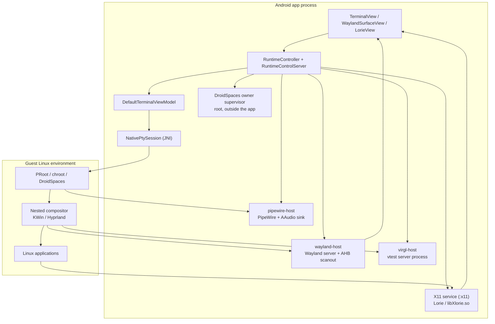
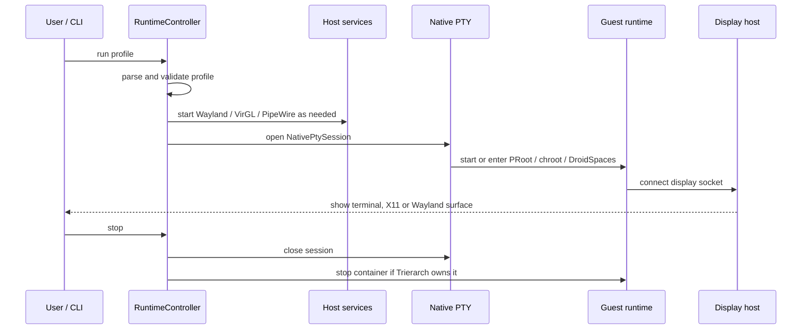

# Architecture and Session Lifecycle

English | [中文](architecture.zh-CN.md)

This document describes how a Trierarch profile moves from the Android UI to a
running Linux session, and how the session is cleaned up. It is a map for
debugging and contribution, not an API reference.

Trierarch is an early-stage project. The layer boundaries below are the
intended design; some display and GPU paths are still changing.

## 1. Layers



The important boundaries are:

- **App process** — Android UI, profile control, PTY creation, IME and input.
- **Guest runtime** — PRoot, chroot or DroidSpaces. It owns the Linux process
  tree, not the Android surface.
- **Display host** — terminal, X11 service, or the Wayland host. It carries
  pixels and input between Android and the guest.
- **Graphics host** — the VirGL/vtest process and the guest Mesa path. It is
  separate from the display host.
- **Lifecycle supervisors** — root helpers that clean up when the app process
  disappears.

## 2. Components

### Android UI

`MainActivity` hosts a `TerminalView`, a `WaylandSurfaceView` and the X11
`LorieView` facade. The floating menu switches between the internal shell, a
runtime terminal, X11 and Wayland, and toggles the keyboard.

Input is delivered through the terminal view, the Wayland surface or the X11
input adapter. The IME bridge is only used on the Wayland desktop path.

### Profile and runtime control

Profiles are TOML files under `files/config/profiles/`. `RuntimeController`
loads a profile, validates it, decides whether a display host is needed, and
starts a `NativePtySession`.

`RuntimeControlServer` exposes the same operations to the bundled
`trierarch` CLI:

```text
trierarch --run ID
trierarch --stop [ID]
trierarch --status [ID]
```

The controller tracks which sessions are running and whether a DroidSpaces
container was started by Trierarch or was already running before it attached.

### Native PTY

`NativePtySession` calls the Rust native library through JNI. Rust builds a
`LaunchSpec`, creates the PTY, starts the privileged shell, forwards terminal
size changes and reports session events back to Kotlin.

For each runtime the launch command is different:

- **PRoot** — the packaged `proot` and `loader` binaries run the rootfs.
- **chroot** — `/system/bin/chroot` enters the rootfs; the owner supervisor
  watches the app.
- **DroidSpaces** — `droidspaces start` starts a stopped container, then
  `droidspaces run` enters it; a root owner supervisor watches the app.

### Runtimes

| Runtime | Process owner | Display |
| --- | --- | --- |
| PRoot | App/PTY child | terminal, X11 or Wayland |
| chroot | `chroot` session + supervisor | terminal, X11 or Wayland |
| DroidSpaces | DroidSpaces init in its namespace | terminal, X11 or Wayland |

PRoot and chroot use an app-private or host rootfs. DroidSpaces creates its own
namespace and init; Trierarch starts it and attaches a display socket. For X11,
the container must be started with the X11 bind; for Wayland, the Wayland
runtime directory is bound into the container.

### Display hosts

**Terminal**: the PTY is the display. No graphical host is started.

**X11**: `com.termux.x11.X11ServerService` runs Lorie in the app's `:x11`
process. A Binder transfers the per-client socket to the main process. Guest
applications connect to `DISPLAY=:0`.

**Wayland**: `wayland-host` (loaded in the app) is the parent compositor and
carries the final surface. The guest starts a nested compositor such as KWin or
Hyprland, which connects to the host over a Unix socket. The host displays the
guest compositor's buffers and forwards input.

### Graphics

- **llvmpipe** — guest software rendering. It is the compatibility path.
- **VirGL** — the host runs the VirGL/vtest server; the guest Mesa uses the
  virpipe driver. On the Wayland path, the compositor's output is carried
  through the host token/AHB path.
- **Adreno** — on supported Qualcomm devices, the guest uses freedreno/kgsl and
  renders directly through the device GPU. This path is Wayland-only.

The GPU stack is split across the app, the host native process and the guest
Mesa. A failure at any one layer can look like a black screen or a software
fallback.

### Audio

`pipewire-host` starts PipeWire, WirePlumber and an AAudio sink. The guest gets
access to the PipeWire/Pulse sockets through a bind mount. Audio is enabled per
profile with:

```toml
[audio]
backend = "pipewire"
```

## 3. Startup sequence



The order matters:

1. The X11 socket or Wayland host must exist before the guest starts a desktop.
2. DroidSpaces must be started with its bind mounts before `droidspaces run`.
3. The root lifecycle supervisor must start before Trierarch starts a container.
4. A DroidSpaces container that was already running is not stopped by Trierarch.

## 4. Shutdown and cleanup

### PRoot

The PRoot process is a child of the app/PTY. Closing the session closes the PTY
and the PRoot process tree ends. No separate root helper is required.

### chroot

The chroot session starts `trierarch-session-supervisor` with the app PID, the
app start time and the session process group:

```text
--owner-pid <pid> --owner-start-time <ticks> --pgid <pgid>
```

The supervisor reads `/proc/<pid>/stat`; if the PID disappears or is reused, it
terminates the session process group. This works even if Magisk reparents the
shell.

### DroidSpaces

A container has its own init and does not die when the PTY closes. Before
starting a stopped container, Trierarch starts an Android-native owner
supervisor with:

```text
--owner-pid <pid> --owner-start-time <ticks> --stop-container <name>
```

When the app process disappears, the supervisor runs:

```sh
droidspaces --name=<name> stop
```

It only runs for containers Trierarch started. Pre-existing containers are left
alone.

## 5. Where to look when it breaks

| Layer | Signal |
| --- | --- |
| Android UI / input | `adb logcat -s TrierarchWayland TrierarchRenderer TrierarchTvg` |
| PTY / native session | app session log and terminal output |
| VirGL host | `files/virgl-run/virgl_host.log` |
| Wayland host | renderer counters in `TrierarchRenderer` |
| Guest compositor | `/tmp/trierarch-wayland/kwin.log` or the compositor's own log |
| chroot supervisor | `/tmp/trierarch-wayland-host/ime/trierarch-session-supervisor.log` |
| DroidSpaces supervisor | `/data/local/tmp/trierarch-droidspaces-supervisor.log` |
| Audio | `pactl info` in the guest, then `paplay` |

A useful first check is whether the display host is producing frames. If the
host renderer shows zero `commits`, the guest compositor is not presenting; if
it shows commits but the screen is wrong, the problem is in the buffer or
composition path, not in the PTY.

## 6. Design boundaries

- Trierarch does not bundle the guest distribution. The user provides a rootfs
  or a DroidSpaces container.
- The Android app and the host native processes do not relicense upstream
  components. See [the product README](../README.md#built-on-other-projects)
  and `UPSTREAM.md` files.
- PRoot is a separate executable, not a library linked into the app.
- DroidSpaces is an external runtime; Trierarch manages only the containers it
  starts.
- X11 is the more stable desktop target today. Wayland compositors move quickly;
  see [compatibility](compatibility.en.md) and
  [known issues](known-issues/README.md).

## 7. Related documents

- [Compatibility matrix](compatibility.en.md)
- [Known issues](known-issues/README.md)
- [English manual](en/README.md)
- [中文手册](zh-CN/README.md)
