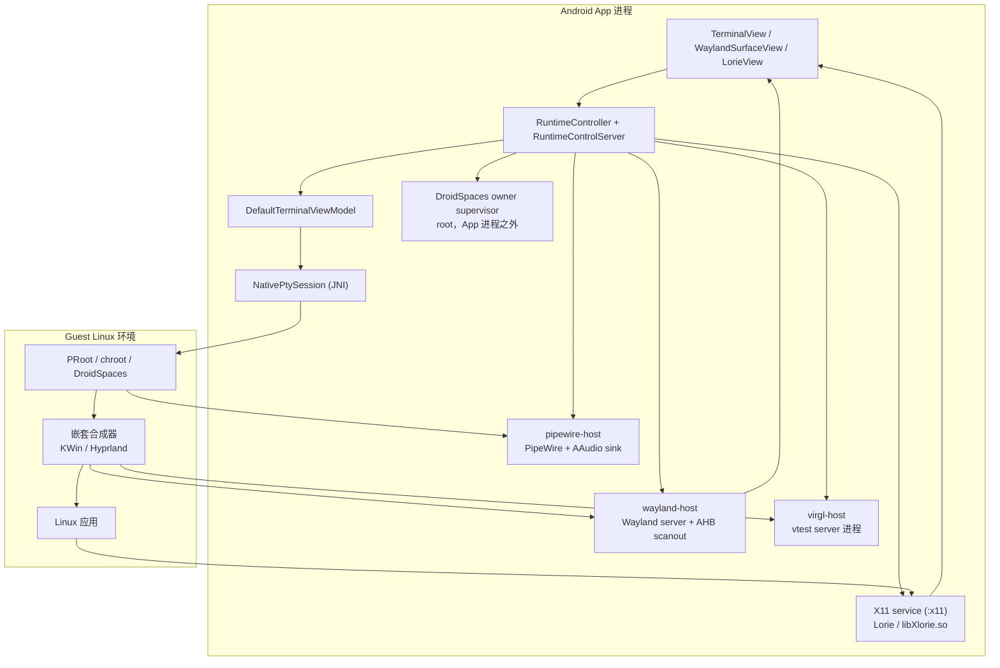
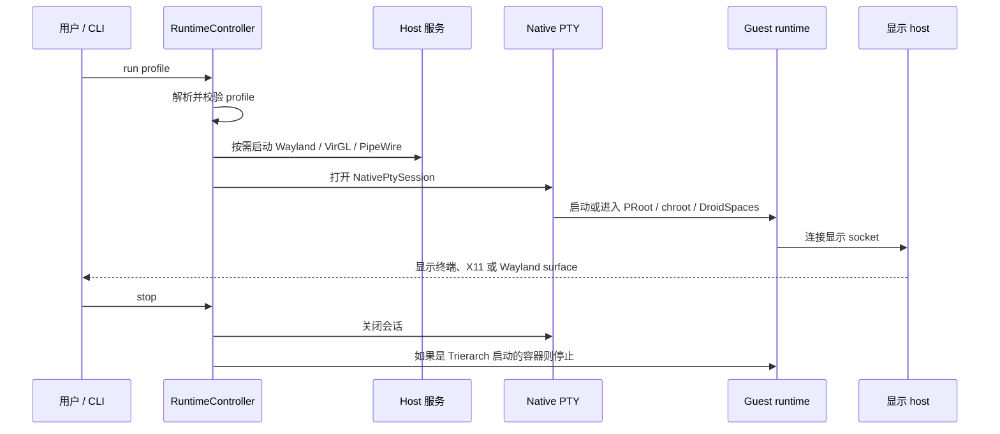

# 架构与会话生命周期

[English](architecture.en.md) | 中文

这份文档说明一个 Trierarch profile 如何从 Android UI 走到运行中的 Linux 会话，
以及会话结束时如何收尾。它面向调试和贡献，不是 API 参考。

Trierarch 仍处于早期阶段。下面的分层是当前设计意图；部分显示和 GPU 路径仍在
变化。

## 1. 分层



关键边界：

- **App 进程**：Android UI、profile 控制、PTY、输入法和输入；
- **Guest runtime**：PRoot、chroot 或 DroidSpaces，拥有 Linux 进程树，不拥有
  Android surface；
- **显示 host**：终端、X11 服务或 Wayland host，在 Android 和 guest 之间搬运
  像素与输入；
- **图形 host**：VirGL/vtest 进程和 guest Mesa 路径，与显示 host 分开；
- **生命周期 supervisor**：root helper，在 App 进程消失时收尾。

## 2. 组件

### Android UI

`MainActivity` 承载 `TerminalView`、`WaylandSurfaceView` 和 X11 `LorieView`。
浮动菜单在内部 shell、runtime 终端、X11、Wayland 之间切换，并控制键盘。

输入通过终端 view、Wayland surface 或 X11 input adapter 进入 guest。IME bridge
只用于 Wayland 桌面路径。

### Profile 和 runtime 控制

Profile 是 `files/config/profiles/` 下的 TOML 文件。`RuntimeController` 负责加载
和校验 profile、决定是否需要显示 host，并启动 `NativePtySession`。

`RuntimeControlServer` 把同样的操作暴露给内置 `trierarch` CLI：

```text
trierarch --run ID
trierarch --stop [ID]
trierarch --status [ID]
```

Controller 会记录哪些会话正在运行，以及 DroidSpaces 容器是 Trierarch 启动的还是
在附着前就已经存在。

### Native PTY

`NativePtySession` 通过 JNI 调 Rust native 库。Rust 构造 `LaunchSpec`、创建 PTY、
启动特权 shell、转发终端尺寸变化，并把会话事件报告给 Kotlin。

不同 runtime 的启动命令不同：

- **PRoot**：运行打包的 `proot` 和 `loader`；
- **chroot**：用 `/system/bin/chroot` 进入 rootfs；owner supervisor 监控 App；
- **DroidSpaces**：`droidspaces start` 启动停止的容器，再用 `droidspaces run`
  进入；root owner supervisor 监控 App。

### Runtime

| Runtime | 进程归属 | 显示 |
| --- | --- | --- |
| PRoot | App/PTY 子进程 | 终端、X11 或 Wayland |
| chroot | `chroot` 会话 + supervisor | 终端、X11 或 Wayland |
| DroidSpaces | DroidSpaces 自己命名空间中的 init | 终端、X11 或 Wayland |

PRoot 和 chroot 使用 App 私有或宿主的 rootfs。DroidSpaces 创建自己的命名空间和
init；Trierarch 负责启动并接上显示 socket。X11 需要在启动容器时绑定 X11
socket；Wayland 需要把 Wayland runtime 目录绑定进容器。

### 显示 host

**终端**：PTY 就是显示，不启动图形 host。

**X11**：`com.termux.x11.X11ServerService` 在 App 的 `:x11` 进程里运行 Lorie。
Binder 把每个客户端的 Unix socket fd 传回主进程。Guest 应用连接
`DISPLAY=:0`。

**Wayland**：`wayland-host`（加载在 App 里）是父合成器，承载最终 surface。
Guest 启动 KWin 或 Hyprland 等嵌套合成器，通过 Unix socket 连到 host。Host
显示 guest 合成器的 buffer，并转发输入。

### 图形

- **llvmpipe**：guest 软件渲染，兼容路径；
- **VirGL**：host 运行 VirGL/vtest server，guest Mesa 使用 virpipe；
  Wayland 路径下，合成器输出通过 host 的 token/AHB 路径承载；
- **Adreno**：支持的 Qualcomm 设备上，guest 使用 freedreno/kgsl 直接走设备
  GPU，仅 Wayland。

GPU 栈跨越 App、host native 进程和 guest Mesa；任何一层失败都可能表现成黑屏或
软件回退。

### 音频

`pipewire-host` 启动 PipeWire、WirePlumber 和 AAudio sink。Guest 通过 bind
mount 访问 PipeWire/Pulse socket。Profile 里这样开启：

```toml
[audio]
backend = "pipewire"
```

## 3. 启动流程



顺序很重要：

1. Guest 启动桌面前，X11 socket 或 Wayland host 必须已经存在；
2. DroidSpaces 必须先带 bind mount 启动，再 `droidspaces run`；
3. Trierarch 启动容器前，root 生命周期 supervisor 必须先启动；
4. 已经在运行的 DroidSpaces 容器不会被 Trierarch 停止。

## 4. 退出与清理

### PRoot

PRoot 进程是 App/PTY 的子进程。关闭会话会关闭 PTY，PRoot 进程树随之结束，不需要
额外的 root helper。

### chroot

chroot 会话启动 `trierarch-session-supervisor`，参数是 App PID、App starttime 和
会话进程组：

```text
--owner-pid <pid> --owner-start-time <ticks> --pgid <pgid>
```

Supervisor 读取 `/proc/<pid>/stat`；PID 消失或被复用时，结束会话进程组。即使
Magisk 把 shell 重新挂到 magiskd，这套也能工作。

### DroidSpaces

容器有自己的 init，关闭 PTY 不会结束它。Trierarch 启动停止的容器前，会先启动
Android-native owner supervisor：

```text
--owner-pid <pid> --owner-start-time <ticks> --stop-container <name>
```

App 进程消失后，supervisor 执行：

```sh
droidspaces --name=<name> stop
```

只对 Trierarch 启动的容器生效；预先存在的容器不动。

## 5. 出问题看哪里

| 层 | 信号 |
| --- | --- |
| Android UI / 输入 | `adb logcat -s TrierarchWayland TrierarchRenderer TrierarchTvg` |
| PTY / native 会话 | App 会话日志和终端输出 |
| VirGL host | `files/virgl-run/virgl_host.log` |
| Wayland host | `TrierarchRenderer` 里的 renderer 计数 |
| Guest 合成器 | `/tmp/trierarch-wayland/kwin.log` 或合成器自己的日志 |
| chroot supervisor | `/tmp/trierarch-wayland-host/ime/trierarch-session-supervisor.log` |
| DroidSpaces supervisor | `/data/local/tmp/trierarch-droidspaces-supervisor.log` |
| 音频 | guest 内 `pactl info`，再试 `paplay` |

先确认显示 host 有没有产帧。如果 host renderer 的 `commits` 是 0，说明 guest
合成器没有提交；如果有 commits 但画面不对，问题在 buffer/合成路径，不在 PTY。

## 6. 设计边界

- Trierarch 不打包 guest 发行版；rootfs 或 DroidSpaces 容器由用户提供；
- Android App 和 host native 进程不会重新授权上游组件；见
  [产品 README](../README.zh-CN.md#上游项目与版权) 和各包 `UPSTREAM.md`；
- PRoot 是独立可执行文件，不链接进 App；
- DroidSpaces 是外部 runtime；Trierarch 只管理自己启动的容器；
- 目前 X11 是更稳定的桌面目标；Wayland 合成器更新很快，见
  [兼容性矩阵](compatibility.zh-CN.md) 和
  [已知问题](known-issues/README.md)。

## 7. 相关文档

- [兼容性矩阵](compatibility.zh-CN.md)
- [已知问题](known-issues/README.md)
- [中文手册](zh-CN/README.md)
- [English manual](en/README.md)
